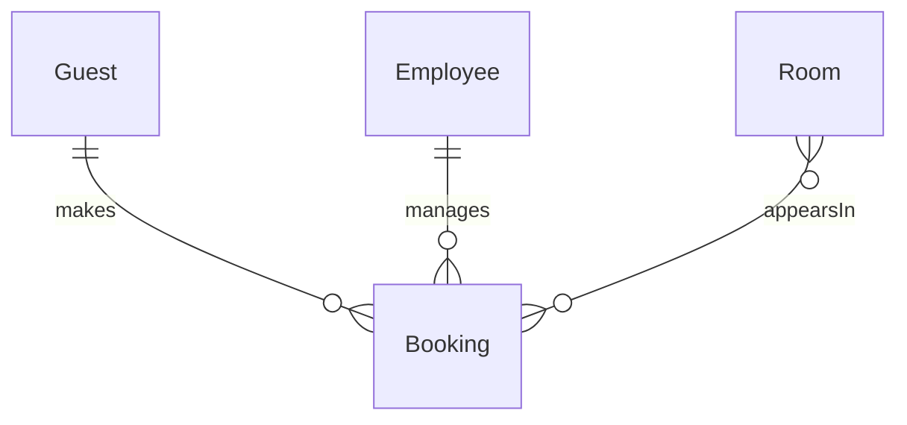

## 1. نظرة عامة على النظام:
النظام يساعد على إدارة حجوزات أحد الفنادق من خلال أتمتة العمليات لأن العمليات التي تتطلب تدخل بشري او ان كانت ورقية قد تسبب أخطاء ف بالتالي تم تصميم هذا النظام لتقليل الأخطاء قدر الإمكان, و أيضاً يسهل على الوظفين  تلبية احتياجات العملاء وزيادة انتاجيتهم  و يسرع من تجربة النزلاء خلال الحجز مما يوفر وقتهم و يقدم لهم تقارير مالية مفصلة. 

يمكن للمدير و الموظف و الضيف التعامل مع هذا النظام ويساعد النظام على إدارة العمليات المالية للضيف من خلال الموظف المسؤول و متابعة حالاته.

تدفق سير العمل المتوقع:
يقوم الضيف بتحميل التطبيق الخاص بالفندق وينشئ حساب بحال انه لم يكن لديه حساب مسبق, و يقدم طلب لحجز غرفة في التاريخ الذي يراه مناسب له, دور النظام يتبلور في التأكد من أن التاريخ الذي تم اختياره متوفر للحجز خلال الفترة المطلوبة وبعد التأكد من ذلك يحدد الضيف عدد الأيام المطلوبة ويدفع رسوم الغرفة فتتحول حالة الغرفة أو الغرف إلى محجوزة مع اشعار بأنه تم الدفع و عند انتهاء مدة الحجز تتغير حالة الغرفة إلى متوفر.

## 2. Database Design

### 2.1 Guests Collection

#### Fields & Data Types

Guest {
    guestID: objectId
    fullName: string
    phoneNumber: string
    emailAddress: string
    nationalID: string
}

Constraints of Guest{
    guestID: Required, Unique
    fullName: Required
    phoneNumber : Required
    emailAddress: Required , Unique
    nationalID: Required , Unique
}

Field Classifications of Guest {
    guestID: Data
    fullName: Data
    phoneNumber: Data
    emailAddress: Data
    nationalID: Data
}

*******************************************

### 2.2 Room Collection

#### Fields & Data Types

Room {
    roomNumber: Number
    pricePerNight: Number
    maxCapacity: Number
    status: String
    type: String

}

#### Constraints

Constraints of Room {
    roomNumber: Required , Unique
    pricePerNight: Required , Min: 0 ,
    maxCapacity: Required ,  Min: 1,
    status: Required, Enum: [Available , Occupied, Maintenance]
    type: Required, Enum: [Single , Double , Suite , Deluxe]
}

#### Field Classifications

Field Classifications of Room {
    
    roomNumber: Data
    pricePerNight: Data
    maxCapacity: Data
    status: Data
    type: Data
}

********************************************

### 2.3 Employee Collection

#### Fields & Data Types

Employee {
    phoneNumber : String
    fullName : String
    role: String
}

#### Constraints

Constraints of Employee {
    phoneNumber : Required
    fullName : Required
    role: Required, Enum: [Receptionist, Manager, Supervisor]
}

#### Field Classifications

Field Classifications of Employee {
    
    phoneNumber : Data
    fullName : Data
    role: Data
}

************************************
### 2.4 Booking Collection

#### Fields & Data Types

Booking {
    guestId: ObjectId
    employeeId: ObjectId
    bookingDate : Date
    checkInDate: Date
    checkOutDate : Date
    status : String
    totalAmount : Number
    rooms: ArrayOfObjects [ 
        {
            room :ObjectId ,
            pricePerNight :Number
        }
    ]
}

#### Constraints

Constraints of Booking {
    guestId : Required , Ref: Guest
    employeeId : Required , Ref : Employee
    bookingDate : Required
    checkInDate : Required 
    checkOutDate : Required
    status : Required , Enum :[Pending , Confirmed , CheckedIn , CheckedOut , Cancelled]
    totalAmount : Required , min: 0
    rooms : Required و minLength: 1 , Ref : room
}

#### Field Classifications

Field Classifications of Booking {
    guestId : Relationship
    employeeId : Relationship
    bookingDate: Data
    checkInDate : Data
    checkOutDate  :Data
    status : Data
    totalAmount : ProblemSolving
    rooms : Array
}

***********************************************
## 3. Mongoose Schema Snippets

### 3.1 Guest Schema

const guestSchema = new mongoose.Schema ({
    fullName: {
        type : String,
        required : true
    },
    email : {
        type : String, 
        required : true,
        unique : true
    }
    phone : { 
        type : String, 
        required : true, 
        unique : false 
    }
    nationalId : {
        type : String,
        required : true,
        uniue : true,
    }
});

### 3.2 Room Schema

const roomSchema = new mongoose.Schema({
    roomNumber : { 
        type : Number,
        required : true,
        unique : true,
    }
    pricePerNight : { 
        type : Number , 
        required : true , 
        min : 0 ,
    }
    maxCapacity :  {
        type : Number,
        required : true, 
        min : 1,
    }
    status : { 
        type : String
        required: ture
        enum : ["Available" , "Occupied" , "Maintenance"]
    }
    type : { 
        type : String , 
        required : true 
        enum : ["Suite" , "Deluxe" , "Single" , "Double"]
    }
});

### 3.3 Employee Schema

const employeeSchema = new mongoose.Schema({
    fullName : { 
        type : String ,
        required : true 
    }
    phone : { 
        type : Stirng,
         required : true ,
        unique : true 
    }
    role :  {
        type : String, 
        required : true, 
        enum :["Receptionist", "Manager", "Supervisor"]
    }
});

### 3.4 Booking Schema

const bookingSchema = new.mongoose.Schema({
    guestId: {
    type: mongoose.Schema.Types.ObjectId, // تخزين معرف الوثيقة 
    ref: " Guest " ,
    required : true ,
}
    employeeId: {
        type: mongoose.Schema.Types.ObjectId,
        ref: "Employee",
        required: true
}
    bookingDate: {
    type: Date,
    required: true,
}
    checkInDate : {
        type : Date,
        required : true
    }

    checkOutDate: { 
        type : Date,
        required : true,
    }
    status :  {
        type  :String
        required : true
        enum  :["Pending" , "Confirmed" , "checkedIn" , "CheckedOut" , "Cancelled"]
    }
    totalAmount : {
        type : Number, 
        required : true,
        min : 0 
    }
rooms: [
    {
    room: {
        type: mongoose.Schema.Types.ObjectId,
        ref: "room",
        required: true
}
        pricePerNight: {
            type : Number, 
            required : true, 
            min : 0 
            }
    }
        validate: {
        validator: function (rooms) {
        return rooms.length >= 1;
        },
        message: "A booking must contain at least one room"
    }
]

  
})

*******************************************
## 4. Relationships & Mermaid ERD

### 4.1 Relationships

#### Guest and Booking
    Relationship Type: One to Many 1<----->M
    Description: النزيل يمكن أن ينشئ عدة حجوزات و الحجوزات تتبع لنفس النزيل

#### Employee and Booking
    Relationship Type: One to Many 1<----->M
    Description: الموظف يمكن أن يسجل عدة حجوزات و هذه الحجوزات تتبع لنفس الموظف

#### Room and Booking
    Relationship Type: Many to Many M<----->M
    Description: الحجز الواحد يمكمن أن يحتوي على عدة غرف بينما الغرفة الواحدة يمكن أن تظهر في حجوزات مختلفة.

### 4.2 Mermaid ERD

****************************
## 5. Business Rules

### 5.1 Stay Nights Calculation
1: عدد الليالي يحسب من الفرق بين تاريخ المغادرة و تاريخ الوصول على سبيل المثال لو الزبون وصل في تاريخ 10 ديسمبر و غادر في 15 ديسمبر ف عدد الليالي يكون خمسة.

### 5.2 Total Amount Calculation
التكلفة الإجمالية تساوي عدد الليالي مضورب في مجموع اسعار الغرف لللية الواحدة, على سبيل المصال لو أن أحد النزلاء حجز غرفتين لمدة ثلاث ليالي سعر الاولى 100 و الثانية 150 فيكون سعر الغرةف للليلة الواحدة هو 250 مضروب في ثلاث ليالي فيكون المجموع النهائي 750.
